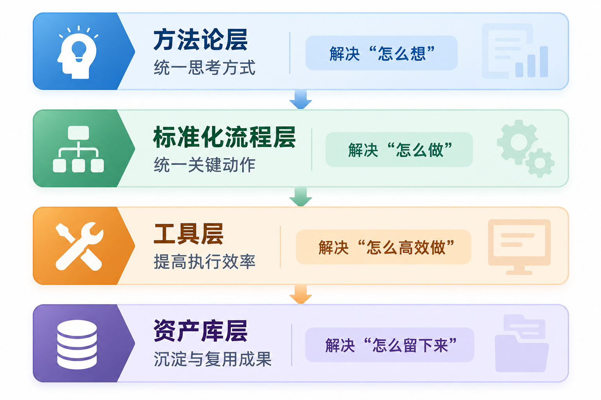
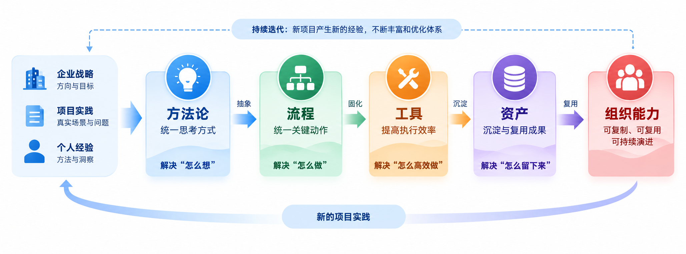

方法论 · 标准化流程 · 工具 · 资产库

解决方案能力，往往最初来自少数人的经验。有人擅长理解客户，有人擅长设计架构，有人擅长写方案，也有人能够在复杂项目中迅速找到关键问题。

但如果这些能力始终停留在个人身上，就很难形成稳定、可复制的组织能力。

我自己做过多年的解决方案，被人带过，也带过解决方案团队，结合我自己的经历，我深刻的理解一个相对成熟的解决方案体系对于团队每个人快速的帮助有多大，对于整个公司提升对外输出的能力影响有多大。我把我对解决方案体系建设的理解，归纳为一个四层框架。

| **方法论 → 标准化流程 → 工具 → 资产库** |
|:---------------------------------------:|

这套四层框架的目标，不是增加制度和文档，而是把个人经验逐步转化为可复制、可复用、可持续积累的组织能力。

# 1. 四层体系

四层分别解决四个问题，怎么想，怎么做，怎么做的更快更好，怎么帮助更多人。

| **层级** | **核心问题** | **典型内容** | **主要价值** |
|:--:|----|----|----|
| **方法论** | 怎么想 | 问题分析框架、方案设计方法、行业方法论 | 统一解决问题的逻辑 |
| **标准化流程** | 怎么做 | 调研、设计、评审、POC、投标、交底、复盘 | 降低执行随机性 |
| **工具** | 怎么高效做 | 模板、清单、表单、知识检索、AI辅助工具 | 降低重复劳动 |
| **资产库** | 怎么留下来 | 方案、案例、架构、产品、项目经验、知识资产 | 支撑持续复用 |

# 2. 方法论层：统一“怎么想”

解决方案首先是一种问题分析能力。如果没有稳定的方法论，方案很容易从“客户有什么问题”变成“我们有什么产品”。

| **业务背景** | **→** | **现状识别** | **→** | **问题分析** | **→** | **需求抽象** | **→** | **建设目标** | **→** | **总体架构** | **→** | **技术路径** | **→** | **实施路线** | **→** | **价值验证** |
|:--:|----|----|----|----|----|----|----|----|----|----|----|----|----|----|----|----|

不同领域的具体方法会变化，但基本逻辑是一致的。

- 数据治理：关注标准、质量、元数据、主数据和数据运营。

- AI项目：关注业务场景、数据准备、知识工程、模型能力和评测闭环。

- 信创项目：关注现状评估、适配关系、迁移路径和验证机制。

- 安全项目：关注资产、威胁、风险、控制措施和持续运营。

| **方法论的价值，不是让所有人写出一样的方案，而是让团队面对陌生问题时拥有稳定的分析起点。** |
|:--:|

# 3. 标准化流程层：把经验变成动作

仅有方法论还不够。真正的项目工作，需要把思考过程进一步转化为可以重复执行的关键动作。

| **商机识别** | **→** | **客户调研** | **→** | **需求分析** | **→** | **方案设计** | **→** | **内部评审** | **→** | **客户汇报** | **→** | **POC/验证** | **→** | **投标响应** | **→** | **项目交底** | **→** | **项目复盘** |
|:--:|----|----|----|----|----|----|----|----|----|----|----|----|----|----|----|----|----|----|

真正需要标准化的，不是所有细节，而是关键节点和关键动作。

客户调研至少应回答：

- 客户当前处于什么状态，真正的问题是什么；

- 已有系统和能力是什么，项目边界在哪里；

- 谁是决策者、使用者和影响者；

- 建设目标、预算、周期和价值判断是什么。

方案评审至少应检查：

- 需求是否覆盖，架构是否闭环；

- 技术路线是否可落地，是否超出产品能力边界；

- 是否存在明显交付风险；

- 核心价值是否能够被验证。

# 4. 工具层：把方法真正落到日常工作

方法论和流程如果只存在于制度文件里，很容易失效。真正把它们带进日常工作的，是工具。工具不一定是软件，也可以是一张表、一个清单或一套模板。

| **工作环节** | **可以固化的工具**                   |
|:------------:|--------------------------------------|
| **客户调研** | 需求调研表、访谈提纲、现状调查表     |
| **需求分析** | 需求清单、痛点分析表、需求追踪矩阵   |
| **方案设计** | 标准方案模板、架构模板、能力矩阵     |
| **技术验证** | POC任务书、测试场景、验收指标        |
|   **投标**   | 招标响应表、偏离检查表、风险检查清单 |
| **项目交接** | 售前交付单、风险清单、关键承诺清单   |
| **项目结束** | 复盘模板、案例模板、经验提炼表       |

工具的本质，是把隐性经验显性化。一个经验丰富的人，也许不用清单就知道该问什么；体系建设则要让这些经验即使脱离某个人，也能够继续被使用。

# 5. 资产库层：从“存文件”到“积能力”

很多企业并不缺资料，缺的是可以真正复用的资产。几十个共享目录、几千份PPT，并不天然等于知识资产。

| **文件只是被保存下来；资产则能够被找到、被理解、被复用。** |
|:----------------------------------------------------------:|

| **资产类型** | **主要内容**                                         |
|:------------:|------------------------------------------------------|
| **行业资产** | 行业业务模型、典型场景、痛点、政策与标准、参考架构   |
| **方案资产** | 标准解决方案、场景方案、技术架构、建设路线、价值模型 |
| **产品资产** | 产品能力、边界、技术参数、兼容关系、FAQ、竞品分析    |
| **项目资产** | 历史方案、POC结果、投标材料、实施经验、风险与复盘    |
| **知识资产** | 技术知识、方法论、标准规范、培训材料、专家经验       |

资产库最终要解决的不是“把东西保存起来”，而是当下一个类似项目出现时，过去的经验能否立即产生价值。

# 6. 四层之间不是并列关系，而是一条沉淀链

| **方法论把经验抽象出来，流程把方法变成动作，工具把动作固化下来，资产库把成果持续留下来。** |
|:--:|

|  **缺失环节**  | **常见结果**             |
|:--------------:|--------------------------|
|  **缺方法论**  | 方案容易变成产品堆叠     |
|   **缺流程**   | 工作质量过度依赖个人状态 |
|   **缺工具**   | 方法难以稳定执行         |
| **缺资产治理** | 大量资料无法真正复用     |

# 7. AI让这套体系产生新的价值

AI正在明显改变解决方案工作的方式：阅读招标文件、整理客户访谈、检索历史项目、提炼需求、生成方案初稿、检查前后矛盾、快速形成原型，都可以获得AI辅助。

但新的核心问题也随之出现：AI到底在使用什么知识？

如果企业没有清晰的方法论、标准流程、结构化工具和经过治理的知识资产，AI最多只能帮助团队更快地产生内容。反过来，当四层体系已经形成，AI就可以成为组织知识和解决方案能力的放大器。

| **方法论** | **→** | **流程** | **→** | **结构化工具** | **→** | **知识资产** | **→** | **RAG / Agent** | **→** | **辅助生成与复用** |
|:--:|----|----|----|----|----|----|----|----|----|----|

| **方法论 + 流程 + 工具 + 知识资产 + AI协同** |
|:--------------------------------------------:|

# 8. 从“专家驱动”走向“体系驱动”

解决方案工作永远需要优秀的人。体系建设的目的不是削弱专家价值，而是让专家经验产生更大的杠杆。

- 专家经验能够被沉淀；

- 普通人员能够快速复用；

- 新人能够沿着体系成长；

- 历史项目能够持续产生价值；

- 新项目又能反过来丰富整个体系。

| **项目实践** | **→** | **经验提炼** | **→** | **方法优化** | **→** | **流程调整** | **→** | **工具完善** | **→** | **资产沉淀** | **→** | **进入新项目** |
|:--:|----|----|----|----|----|----|----|----|----|----|----|----|

# 结语

我理解的解决方案体系建设，本质上不是建设一个资料库，也不是编写一套制度。它真正要完成的是：让经验可以被总结，让方法可以被执行，让成果可以被复用，让个人能力逐渐沉淀为组织能力。

| **方法论统一思考方式｜标准化流程统一关键动作｜工具提高执行效率｜资产库形成长期积累** |
|:--:|

AI正在让这套体系拥有新的可能。当组织已经具备高质量的方法、流程和知识资产以后，AI能够进一步把这些能力转化为更高效、更规模化的解决方案生产能力。

最终需要建设的，不是一批方案文档，而是一套能够不断学习、不断复用、不断进化的解决方案能力体系。
