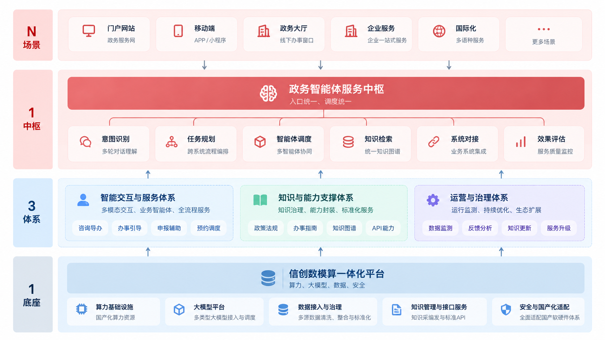

# 基于信创底座的政务智能体总体解决方案

> **从“能办”到“智办”的政务服务模式重构**  
> 山峰智能 · 2026

## 内容概要

政务智能体建设的目标，不应停留在为既有门户增加一个智能问答窗口，而应从群众和企业的完整办事需求出发，整合事项知识、业务流程、模型能力和服务入口，推动政务服务从“用户适应系统”向“系统理解用户”转变。

本方案提出以**信创数模算一体化平台**为统一底座，以**政务智能体服务中枢**为协同枢纽，构建涵盖智能交互、知识能力、运营治理的服务体系，并面向门户、移动端、政务大厅、企业服务及国际化服务等场景持续扩展。方案重点是通过统一建设、能力复用和长期运营，形成可持续演进的政务智能服务体系。

## 目录

- [一、建设背景：从信息供给走向智能服务](#一建设背景从信息供给走向智能服务)
- [二、问题识别：政务诉求与碎片化系统之间的鸿沟](#二问题识别政务诉求与碎片化系统之间的鸿沟)
- [三、建设范式：从外挂工具走向体系化重构](#三建设范式从外挂工具走向体系化重构)
- [四、总体架构：“1-1-3-N”政务智能体体系](#四总体架构1-1-3-n政务智能体体系)
- [五、基础底座：信创数模算一体化平台](#五基础底座信创数模算一体化平台)
- [六、智能体矩阵：贯通办事全流程](#六智能体矩阵贯通办事全流程)
- [七、典型场景：从业务咨询到连续办理](#七典型场景从业务咨询到连续办理)
- [八、知识基座：构建可治理的统一政务知识体系](#八知识基座构建可治理的统一政务知识体系)
- [九、运营治理：建立持续优化闭环](#九运营治理建立持续优化闭环)
- [十、能力开放：统一中枢与多渠道复用](#十能力开放统一中枢与多渠道复用)
- [十一、建设价值与模式转变](#十一建设价值与模式转变)
- [十二、结语](#十二结语)

---

## 一、建设背景：从信息供给走向智能服务

政务信息化建设长期围绕业务系统、服务门户与事项公开展开，为公众提供了在线查询和办理入口。然而，信息能够在线获取，并不意味着群众能够轻松理解规则、找到正确路径并完成业务办理。传统服务模式往往要求办事人自行阅读政策、对照办事指南、判断申请条件，再根据不同部门和系统的要求完成操作。

政务智能体旨在改变上述人机交互关系：系统根据自然语言诉求识别事项，结合政策与办理规则辅助理解，并在咨询、材料准备、申报和预约等环节提供连续引导。其核心是将“信息供给”升级为“面向需求的服务组织”。

| 服务环节 | 传统信息供给模式（能办） | 智能服务模式（好办、易办、智办） |
| --- | --- | --- |
| 规则理解 | 用户自行查阅并理解政策 | 系统辅助解释政策与规则 |
| 路径选择 | 用户自行寻找事项和入口 | 系统识别意图并主动引导 |
| 业务办理 | 用户自行组织材料与办理步骤 | 系统围绕全过程提供协同辅助 |

因此，建设的核心主张是：**以信创底座为基础，以智能体为载体，形成可持续演进的政务智能服务体系。**

## 二、问题识别：政务诉求与碎片化系统之间的鸿沟

现有政务服务中，面向用户的自然语言诉求与后台按部门、事项和系统边界组织的服务能力之间仍存在明显差距，集中表现为以下四类问题。

**意图理解能力不足。** 部分服务工具主要依据关键词匹配，难以充分理解用户在自然语言中表达的复合需求，也难以通过多轮交互补齐办理条件。

**流程割裂与频繁跳转。** 咨询、材料准备、在线申报、预约办理可能分别位于不同平台。用户虽然能够在线获取入口，但仍需自行串联完整流程。

**知识分散且更新滞后。** 政策法规、办事指南、热点问答及部门业务数据分布在不同渠道，更新周期和解释口径可能不一致，使统一答复和溯源验证面临困难。

**重复建设与能力分散。** 如果每个部门和渠道分别建设模型、知识库与服务接口，容易造成基础资源重复投入、服务标准差异和后续运维成本增加。

针对上述问题，本方案通过政务智能体推动**精准意图识别、无缝流程协同、统一知识支撑与集约化建设**。

## 三、建设范式：从外挂工具走向体系化重构

政务智能体不是简单叠加在现有网站上的对话框，而是围绕基础资源、业务服务对象、服务连续性和运营机制进行统筹建设。

| 重构维度 | 原有建设倾向 | 目标建设方式 | 关注重点 |
| --- | --- | --- | --- |
| 基础层面 | 重复建设基础设施 | 统一信创数模算底座 | 国产化适配、安全可控与资源复用 |
| 对象层面 | 堆叠抽象技术能力 | 封装面向业务的智能体 | 将技术能力转为可理解的服务对象 |
| 服务层面 | 单点问答与检索 | 全过程连续服务 | 咨询、引导、申报、预约相衔接 |
| 运行机制 | 一次性交付、缺少更新 | 知识治理与持续运营闭环 | 保持知识与服务能力长期有效 |

这一转变意味着项目不仅要建设模型接入和交互界面，还需要同步规划知识治理、业务接口、运行监管和迭代机制。

## 四、总体架构：“1-1-3-N”政务智能体体系

本方案采用“**1 个底座、1 个中枢、3 类体系、N 个应用场景**”的总体架构，将通用资源、业务协同和多渠道服务分层组织。

**1 个底座：信创数模算一体化平台。** 统一承载算力资源、大模型能力、数据治理、知识管理、接口服务以及安全与国产化适配能力，为上层智能体提供可复用的运行条件。

**1 个中枢：政务智能体服务中枢。** 面向多渠道提供统一的交互入口和服务调度能力，负责意图理解、服务匹配以及跨智能体、跨系统的流程协同，是连接服务场景和底层能力的关键环节。

**3 类体系：智能交互与服务体系、知识与能力支撑体系、运营与治理体系。** 三者分别承担面向用户的连续服务、面向智能体的知识与能力供给，以及面向全生命周期的运行管理和优化。

**N 个场景：** 包括门户网站、移动端、政务大厅、企业服务、国际化服务等。通过统一能力封装与开放接口，支持不同部门、不同渠道按实际需求复用和扩展。

> 架构图为根据原方案重绘的表达性图示。其中，中枢内部的意图识别、任务规划、智能体调度等模块是对原方案“入口统一、调度统一”及相关能力的可视化展开，不等同于已经完成的具体产品功能清单。

## 五、基础底座：信创数模算一体化平台

智能体的运行质量不仅取决于大模型本身，还依赖数据质量、知识供给、统一接口和安全运行环境。本方案将这些共性能力下沉至统一信创数模算一体化平台，避免按场景分别建设基础资源。

**模型运行与调度。** 提供多类型大模型接入与统一调度能力，为不同场景的语言理解、知识问答及业务引导提供模型服务，并保留后续模型选型与替换空间。

**数据接入与治理。** 统一处理来自政务业务系统的多源数据，开展清洗、整合、标准化，为知识组织和业务服务提供可靠的数据基础。

**统一知识管理与接口服务。** 围绕知识采集、编制、审核、发布与更新进行管理，通过标准化 API 向不同智能体开放知识和共性服务能力。

**安全与国产化适配。** 在基础设施、软硬件适配、系统接入和服务运行环节落实安全可控要求。具体产品兼容性、等保及数据安全要求，应在落地项目中依据部署环境和采购规范进一步验证。

## 六、智能体矩阵：贯通办事全流程

方案设计了四类面向办理链条的业务智能体，并非将全部任务交由一个通用问答模型完成，而是根据不同环节的服务目标进行能力分工。

| 智能体 | 服务定位 | 主要职责 |
| --- | --- | --- |
| 咨询导办智能体 | 服务第一触点 | 自然语言咨询、语义理解、事项识别与服务入口匹配 |
| 办事引导智能体 | 流程执行转化 | 结构化拆解办理流程、生成办理路径并进行动态引导 |
| 申报辅助智能体 | 规范填写辅助 | 解释表单字段、校验填写规则、检查提交材料完整性 |
| 预约调度智能体 | 线下资源协同 | 匹配办理时间与地点、协助窗口资源分配及取号联动 |

这四类能力共同支撑从“提出诉求”到“办结业务”的服务过程。需要注意的是，完整的跨系统办理闭环不仅要求智能体能够理解和规划，还要求各业务系统提供可调用的流程、查询、申报或预约接口；当业务接口尚未开放时，应明确区分**辅助引导**和**系统代办**两类能力边界。

## 七、典型场景：从业务咨询到连续办理

### 7.1 多事项协同办理：“我想开店”

例如，市民提出“我想开个小餐馆，需要办什么手续？”传统方式通常要求用户分别查询市场监管、食品经营等事项，并自行确认办理顺序。

在智能体服务模式下，咨询导办智能体首先识别餐饮经营相关诉求，并梳理营业执照、食品经营许可等可能涉及的办理事项；办事引导智能体根据事项要求组织办理步骤，说明身份证明、经营场所材料、平面布局图等可能需要准备的资料；申报辅助智能体提供字段解释和填写规则检查；预约调度智能体则在需要线下办理时推荐可用窗口及时间。

由此实现从分散咨询到连续引导的服务体验。**实际事项清单、办理条件与顺序应以属地现行政策和事项清单为准**，智能体不应仅凭通用行业知识作出确定性的许可结论。

### 7.2 义务教育入学：复杂政策精准匹配

在义务教育入学咨询场景中，家长可能仅提出“孩子上小学需要准备什么”。智能体需要通过多轮交互了解户籍、房产等与属地入学规则相关的情况，匹配本地政策，并整理适用的办理路径与材料要求。

此类场景的关键不在生成流畅的解释，而在于将动态变化的政策条件结构化，准确识别适用范围、政策版本和例外情形，确保输出具有明确依据。

### 7.3 国际化多语种服务：跨语言一致性

对于外籍人员提出的 “How can I apply for a residence permit?”，智能体可识别输入语种，映射到本地居留许可相关事项，并以用户能够理解的语言解释申请材料、办理地点和流程，在连续对话中保持语言及上下文一致。

多语种服务不仅需要翻译能力，还需要确保不同语言输出的政策口径一致，尤其是事项名称、条件限制、材料清单及办理时限等关键信息。

## 八、知识基座：构建可治理的统一政务知识体系

政务智能体的知识来源包括分散的政策法规、办事指南、热点问答及跨部门数据。要减少知识更新滞后和答复口径不一致的问题，需要建立统一的知识治理流程，而非仅将文件集中上传至知识库。

知识处理流程可划分为五个相互衔接的环节：**统一采集 → 清洗过滤 → 语义标签 → 严格审核 → 结构化发布**。

统一采集明确来源、责任主体和更新机制；清洗过滤处理重复、过期及格式不规范的内容；语义标签关联事项、政策主题、适用地域、对象及有效期等信息；严格审核确保内容正确、口径一致；结构化发布则将审核后的知识以可检索、可引用的形式提供给业务智能体。

知识库建设的目标不只是能够检索文本，还应使关键答复具备可理解、可引用、可追溯的依据。当政策发生调整时，应能及时更新知识并识别受影响的服务场景。

## 九、运营治理：建立持续优化闭环

政务知识、办理流程和用户诉求会持续变化，因此智能体不宜采用“一次上线、长期不变”的静态交付模式。原方案提出以实时监测、分析反馈、动态优化和服务升级构成持续运行闭环。

| 运营环节 | 主要内容 | 作用 |
| --- | --- | --- |
| 实时监测 | 访问量、响应时效、满意度、办结转化率 | 掌握服务运行和使用情况 |
| 分析反馈 | 未命中问题、知识盲区、流程短板 | 识别影响服务效果的具体问题 |
| 动态优化 | 知识补充更新、模型优化、交互逻辑调整 | 改善答复质量和业务体验 |
| 服务升级 | 能力发布、场景持续扩展 | 支撑新需求和新业务接入 |

在具体实施时，各项指标还需要明确统计口径、数据来源和责任主体。例如，“办结转化率”应区分智能体完成引导、用户提交申请和业务系统确认办结，避免将不同阶段的结果混为一谈。

## 十、能力开放：统一中枢与多渠道复用

统一能力中枢通过标准化 API、组件化封装和可视化服务编排，向全市统一政务门户、12345 服务热线、部门特色业务小程序及线下大厅自助终端等渠道提供服务。

这一模式的重点在于**建设一次共性能力、由多个渠道按需复用**。不同渠道可以保留差异化的交互方式和服务流程，同时共享经过治理的政策知识、事项理解与通用智能能力。

需要指出的是，统一中枢并不意味着替代所有存量业务系统。更现实的建设方式是在保留各部门业务权责和业务系统边界的基础上，建立可控的能力调用、身份权限和流程衔接机制。

## 十一、建设价值与模式转变

与传统工具式建设相比，政务智能体生态更重视服务的连续性、底座的统一性以及运营的长期性。

| 比较维度 | 传统模式 | 政务智能体生态 |
| --- | --- | --- |
| 服务模式 | 被动响应，侧重单一问答与信息检索 | 围绕完整办事诉求提供连续引导与辅助 |
| 建设模式 | 多个项目分别堆叠功能，缺乏统筹 | 依托统一底座和中枢开展体系化建设 |
| 业务协同 | 部门能力分散、投入重复、标准不一 | 通过标准接口实现跨部门、跨场景能力复用 |
| 生命周期 | 上线后知识和服务能力容易老化 | 通过知识治理与反馈机制持续演进 |

方案的长期价值，应通过可核验的业务指标评估，包括用户寻找办事入口的成本、咨询答复准确性、事项引导完成情况、知识更新时效、跨渠道能力复用程度和运维投入等。上述价值属于建设目标，实际改善程度需要在试点与运营中持续测量。

## 十二、结语

政务智能体的建设方向，是从“让用户适应系统”走向“让系统理解用户”。其实现路径并非只依靠更强的大模型，而是将可信知识、政务流程、统一底座、智能体编排以及安全治理整合为持续运行的服务体系。

通过“1-1-3-N”架构，政务部门可以在统一技术基础上逐步建设跨场景、跨渠道的智能服务能力，以知识治理和运营反馈支撑长期演进，推动政务服务从信息供给走向连续、可理解、可协同的智能服务。

---

*说明：本文根据《基于信创底座的政务智能体总体解决方案》演示材料整理，侧重方案架构、能力组织及典型应用场景。文中场景为方案性描述，不代表相应业务系统已完成部署或实现自动审批。*
