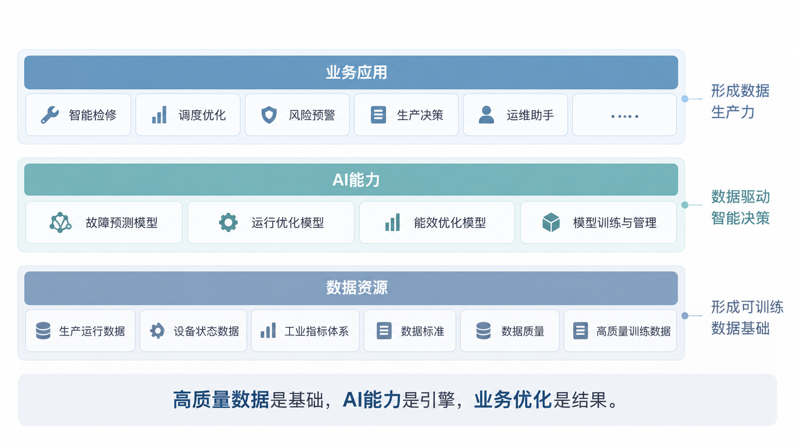
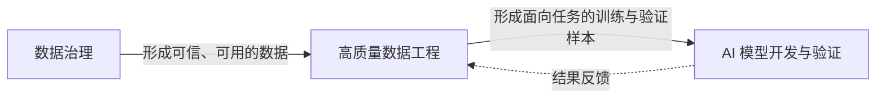
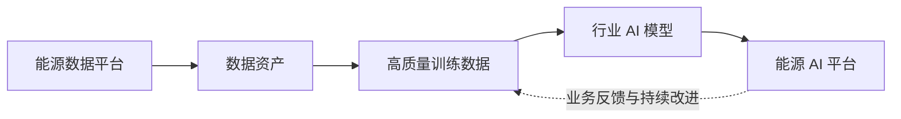
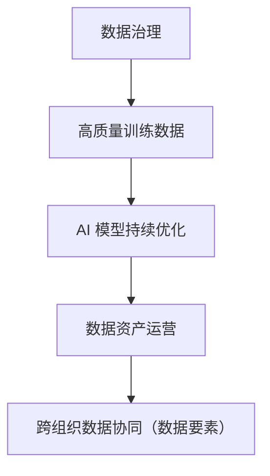

# 基于高质量数据与 AI 驱动的智慧火电数字化升级路径

> **构建能源数据生产力的演进框架**
>
> 作者：李枫

## 内容概要

能源行业的数字化建设正在从以业务系统部署、数据采集和信息集成为重点的阶段，逐步向以高质量数据、人工智能和业务持续优化为核心的阶段演进。对于生产过程复杂、设备系统耦合程度高的火电企业，数字化升级的关键不只是增加系统和算法，而是建立从**数据治理、高质量训练数据、AI 模型到生产经营优化**的完整能力链条。

本文围绕火电行业的数据特点与典型应用场景，讨论智慧火电的总体技术架构、数据工程能力、能源 AI 平台演进方向，以及数据生产力的业务价值和长期发展路径。

## 目录

- [一、能源行业数字化进入数据生产力阶段](#一能源行业数字化进入数据生产力阶段)
- [二、火电、水电与风电数字化路径对比](#二火电水电与风电数字化路径对比)
- [三、数据治理驱动 AI 的智慧火电总体架构](#三数据治理驱动-ai-的智慧火电总体架构)
- [四、高质量数据集：数据生产力的基础设施](#四高质量数据集数据生产力的基础设施)
- [五、AI 驱动火电的数据生产力应用场景](#五ai-驱动火电的数据生产力应用场景)
- [六、从能源数据平台到能源 AI 平台的能力演进](#六从能源数据平台到能源-ai-平台的能力演进)
- [七、数据生产力的商业价值与收益路径](#七数据生产力的商业价值与收益路径)
- [八、数据资产与数据要素：远期发展方向](#八数据资产与数据要素远期发展方向)

---

## 一、能源行业数字化进入数据生产力阶段

能源企业的数字化转型正在从传统的“信息化建设”向“数据驱动运营”转变。随着成本控制、运行效率、安全生产及“双碳”相关要求不断提升，单纯依靠业务系统建设和生产数据汇集，已难以充分支持生产优化与经营决策。

对于火电企业而言，生产运行涉及多类型设备与连续工艺过程，数据来源广泛，运行条件动态变化。传统生产系统之间存在的数据割裂、数据利用不足，以及依赖人工经验开展运维和决策等问题，限制了数据价值的进一步释放。

当前主要挑战集中在三个方面：

1. **生产数据价值尚未充分释放。** 尽管生产系统持续产生大量数据，但这些数据未必具备跨系统关联分析和模型训练所需的一致性、完整性与业务语义。
2. **生产运维与经营决策对经验依赖较强。** 数据未能有效支撑可重复、可验证的预测分析和持续优化过程。
3. **数据治理与业务价值缺少反馈闭环。** 治理工作往往停留在数据质量改善与标准化阶段，尚未充分建立面向实际业务成效的持续迭代机制。

因此，智慧火电建设需要将数据治理与 AI 应用结合起来：**通过数据治理形成可用、可信的数据基础，通过高质量数据工程支撑模型开发与应用，并在业务反馈中持续提升数据和模型的价值。**

## 二、火电、水电与风电数字化路径对比

不同类型电源的生产运行方式和数据形态存在明显差异，其数字化建设重点也不相同。

| 对比维度 | 火电（复杂工业过程型） | 水电（资源调度型） | 风电（设备运维型） |
| --- | --- | --- | --- |
| 生产特征 | 多设备耦合、复杂工艺链 | 水资源调度驱动 | 分布式设备运行 |
| 数据特征 | 高维连续时序数据 | 时空数据为主 | 海量设备 IoT 数据 |
| 核心优化目标 | 生产效率与能耗优化 | 调度效率优化 | 设备健康管理 |
| 数据治理重点 | 工业语义与设备关系建模 | 时空数据建模 | 设备状态建模 |
| AI 应用重点 | 生产优化、预测性维护 | 调度优化与预测 | 故障预测与运维 |
| 数据复杂度（定性比较） | ★★★★★ | ★★★ | ★★★★ |
| 数据生产力空间（定性比较） | ★★★★★ | ★★★ | ★★★★ |

> **说明：** 星级为原方案基于典型业务形态所作的定性比较，非基于统一样本、定量模型或行业统计得出的评估结果，不宜直接用于投资优先级或经济收益判断。

火电机组涉及燃烧、汽水、热力、电气及辅助系统等复杂的运行关系，具有多变量、强耦合、连续运行等典型工业过程特征。此类场景不仅要求对单个设备状态进行监测，更需要建立设备、工况、工艺参数及运行指标之间的关联关系。

相较之下，水电数字化通常更加关注水资源、时空条件及调度优化；风电则更加关注分布式设备状态、故障预测与运维效率。由此可见，**火电是适合探索高质量工业数据与 AI 深度融合的重点场景之一**，其价值空间需要结合机组类型、存量数字化基础和具体业务指标进一步验证。

## 三、数据治理驱动 AI 的智慧火电总体架构

智慧火电的技术体系可以按照**数据资源、AI 能力和业务应用**三个层次组织，构成由数据支撑智能分析、由智能分析促进业务优化的能力链条。

**数据资源层**负责汇聚生产运行数据、设备状态数据和工业指标，结合数据标准与数据质量管理，形成面向分析和训练的数据基础。此处的重点不只是数据接入，还包括工业语义理解、数据关联以及样本的质量管理。

**AI 能力层**围绕故障预测、运行优化、能效优化等任务，建立模型训练、管理和迭代能力。不同业务场景所使用的模型类型、输入数据和验证指标应根据实际需要选择。

**业务应用层**将模型输出转化为智能检修、调度优化、风险预警、生产辅助决策与运维知识服务等具体能力，使技术建设与生产经营活动形成联系。

三个层次的关系并非一次性、单向的数据传递。业务系统产生的新工况、模型预测结果与实际处置反馈，还应回到数据管理和模型优化环节，逐步形成闭环。

**高质量数据是基础，AI 能力是引擎，业务优化是结果。**

## 四、高质量数据集：数据生产力的基础设施

### 4.1 从数据可用走向数据可训练

传统数据治理的主要任务是通过数据标准、质量管理和数据管理流程提升数据的可用性。面向 AI 的高质量数据工程则需要进一步考虑数据是否适合特定建模任务，包括样本覆盖范围、标注与业务语义、数据时序一致性、训练验证划分，以及后续的数据版本管理等。

因此，传统数据治理与高质量训练数据建设不是相互替代的关系，而是能力递进关系：前者解决数据可用性问题，后者进一步解决面向具体 AI 任务的可训练性问题。

### 4.2 高质量数据工程的核心能力

**训练数据管理与版本控制。** 对模型所使用的数据来源、处理过程、样本范围与数据版本进行管理，支持训练结果追溯和后续迭代。

**标签体系与工业语义建模。** 围绕设备、工况、故障、运行指标等业务对象建立统一定义，使样本能够正确反映实际生产状态及其关联关系。

**样本质量评估与可训练性验证。** 检查数据的完整性、一致性、异常情况和样本适用性，识别对模型训练与验证具有影响的数据问题。

**数据漂移监测与持续优化。** 跟踪机组运行工况、设备状态及数据分布的变化，识别历史样本与实际运行环境之间出现的差异。

**模型反馈驱动的数据闭环。** 将模型预测偏差、业务验证结果与现场反馈纳入数据改进过程，使数据建设从一次性整理转向持续迭代。

高质量数据对模型能力有重要影响，但模型效果还受算法、任务定义、运行环境及验证机制等因素制约。因此，不能把高质量数据建设简单等同于模型效果得到保证。

## 五、AI 驱动火电的数据生产力应用场景

火电 AI 应用可以从生产效率、运行可靠性、经营管理和安全风险等方向展开。

### 5.1 机组运行效率优化

通过实时工况分析、燃烧优化和能效分析，辅助识别影响机组运行效率的关键因素，并为降低煤耗、控制排放等目标提供分析支持。此类应用需要结合机组实际工况和运行约束开展验证。

### 5.2 设备预测性维护

通过设备状态分析、故障预测及剩余寿命评估，为检修安排提供辅助依据，目标在于降低非计划停机风险、优化检修周期并提高生产可靠性。实际应用应关注预测准确性、误报漏报成本和现场检修决策机制。

### 5.3 燃料采购与储运管理

将煤质预测、采购策略分析、库存管理和物流调度等环节连接起来，为燃料成本控制和供应稳定性提供数据支持。该场景既依赖生产侧煤质与消耗数据，也需要经营侧的采购、库存和物流信息。

### 5.4 安全生产与风险预警

利用异常工况检测、事故风险预测和安全预案辅助分析，提高风险识别与辅助处置能力。相关模型应作为安全管理体系的辅助能力，并与既有生产安全控制、现场确认和应急管理机制衔接。

### 5.5 运维知识助手

通过运维日志分析、故障知识库与智能问答等方式，提高技术资料检索、历史经验复用和日常运维知识获取的效率。其输出应基于可核验的业务资料，关键操作仍需执行相应的专业审核与现场规程。

上述场景覆盖从生产设备到经营管理的多个环节，但不意味着所有场景都需要同步建设。实际推进时，应结合数据基础、业务痛点和效益验证结果确定实施顺序。

## 六、从能源数据平台到能源 AI 平台的能力演进

### 6.1 当前基础：能源数据平台

能源数据平台重点解决**数据可用**问题，通常以多源能源数据采集与集成、数据治理、数据质量管理、时序数据处理分析，以及数据建模与数据服务为核心能力。

这一阶段为跨系统数据使用提供基础，但并不天然具备支持 AI 持续训练、上线运行和反馈优化的完整能力。

### 6.2 升级方向：能源 AI 平台

在已有数据平台基础上，进一步建设高质量训练数据工程体系、面向行业任务的 AI 模型能力，以及模型运营和持续优化能力，推动平台从数据汇聚、分析服务向数据驱动的业务优化延伸。

其中，行业 AI 模型可以根据任务采用专用预测模型、优化模型或其他适当的 AI 技术路线，并不局限于某一种模型架构。

平台升级的重点不是替换已有能源数据平台，而是在保留数据集成和治理能力的基础上，扩展面向训练数据、模型管理及业务应用闭环的能力。

## 七、数据生产力的商业价值与收益路径

### 7.1 业务价值

智慧火电建设的价值最终需要体现在可观察的业务结果上。原方案提出的主要价值方向包括：

| 价值方向 | 对应的业务改善目标 |
| --- | --- |
| 运维优化 | 降低运维成本与非计划停机风险 |
| 运行优化 | 提升机组效率与安全运行水平 |
| 经营优化 | 优化燃料管理与运营效率 |
| 管理支撑 | 支撑“双碳”相关管理及监管要求 |
| 能力建设 | 形成持续的数据运营和优化能力 |

上述内容属于**预期价值方向**，而非已验证的经济收益。具体项目应通过基准指标、试点验证及持续监测来评估实际效果。

### 7.2 商业模式演进

随着能力建设逐步深入，相关服务模式可以由一次性项目交付，向平台能力服务、数据运营服务和 AI 持续优化服务拓展。

这一路径意味着服务关注点从系统是否建成交付，逐步转向数据是否持续可用、模型是否持续有效、业务效果能否被验证与改善。各阶段可根据客户需求并行开展，不构成所有项目必须采用的商业模式。

## 八、数据资产与数据要素：远期发展方向

从长期发展来看，火电企业的数据能力建设还可能进一步由内部生产优化走向数据资产运营，并探索跨组织的数据协同与数据要素应用。

这一演进过程以数据治理和高质量数据建设为基础，通过 AI 模型持续优化形成可积累的数据应用能力，再结合数据资产运营探索更广范围的协同价值。

需要区分的是，内部数据资产运营与跨组织数据要素流通并非同一层面的工作。后者还涉及数据权属、使用授权、安全合规、商业规则等前提，不能仅凭技术平台建成而自然实现。因此，**数据要素应作为数据生产力发展的远期方向，而不宜替代近期面向生产效率和经营优化的落地目标。**

## 结语

智慧火电的数字化升级不是从传统数据平台直接跳转到 AI 应用，而是一个逐层积累、持续验证的过程。首先需要通过数据治理建立可靠的数据基础，进一步形成面向具体任务的高质量训练数据，再结合生产场景建设和验证 AI 模型，并通过业务反馈不断调整数据与模型能力。

对于火电企业，判断数字化升级是否有效，应重点考察其能否形成从**数据治理 → 高质量数据 → AI 模型 → 业务应用 → 持续优化**的闭环，而不是单纯以部署系统数量、汇聚数据规模或上线模型数量衡量建设成效。

---

*本文根据《基于高质量数据与 AI 驱动的智慧火电数字化升级路径》方案整理为 GitHub 阅读版本，在保留原有论述框架的基础上进行了行文调整、图表转换及必要的技术表述限定。*
