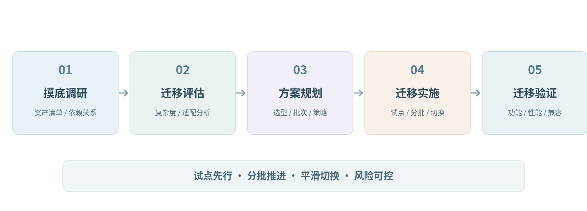

# 信创迁移项目解决方案

> 面向政府、央国企及重点行业信息系统的国产化迁移、架构升级与持续治理。

**方案来源：**《信创迁移项目解决方案框架示例》（立山大数据）。本文依据原始方案整理，方案中的产品能力、实施经验及效果描述保留原稿立场，不构成第三方独立验证。

## 目录

- [1. 方案概述](#section-1)
- [2. 行业发展趋势与信创战略升级](#section-2)
- [3. 客户面临的主要挑战](#section-3)
- [4. 信创迁移解决方案总体思路](#section-4)
- [5. 总体技术架构设计](#section-5)
- [6. 信创迁移实施路径](#section-6)
- [7. 迁移模式对比分析](#section-7)
- [8. 风险矩阵与风险控制机制](#section-8)
- [9. 迁移评估指标体系](#section-9)
- [10. 持续服务能力与运营支撑体系](#section-10)
- [11. 核心价值](#section-11)

---

## 一、方案概述

在数字中国战略和信息技术应用创新（信创）工程持续推进的背景下，信息系统国产化升级已成为政府、央国企及重点行业单位信息化建设的重要任务。随着“十五五”规划将新质生产力确立为国家发展的核心方向，信创建设也正在从单纯的国产替代，逐步升级为支撑数字经济发展的重要数字基础设施工程。

然而，信创迁移并不是简单的软件替换过程。多数单位现有信息系统经过多年建设和持续演进，系统依赖关系复杂、数据库规模庞大、接口调用频繁，直接迁移往往面临系统稳定性、数据一致性以及业务连续性等多方面风险。同时，许多单位IT团队规模有限，在迁移评估、技术路线规划以及实施组织方面缺乏系统经验，难以独立推进复杂的信创迁移项目。

针对上述问题，立山大数据提出以“平滑迁移、架构升级、统一治理、持续赋能”为核心思路的信创迁移解决方案。通过系统化迁移规划与统一技术架构建设，在保障业务稳定运行的前提下完成国产化升级，同时推动信息系统架构优化与IT治理能力提升，逐步构建统一数字基础设施底座，为未来数字化发展提供长期稳定的技术支撑。

## 二、行业发展趋势与信创战略升级

随着我国数字经济进入高质量发展阶段，信息技术基础设施的重要性不断提升。信息技术应用创新（信创）工程作为国家推动信息技术体系自主可控的重要战略，在“十四五”期间已经在党政、金融、能源等重点领域取得阶段性成果，初步建立起以国产CPU、操作系统、数据库及中间件为核心的信息技术产业体系，为我国信息技术体系自主可控奠定了基础。

从国家发展战略角度来看，信创产业的发展逻辑正在发生深刻变化。在“十四五”时期，信创建设的主要目标是补齐关键技术短板，通过重点行业国产化替代，逐步解决信息技术领域“卡脖子”问题，使我国信息技术体系具备基本自主可控能力。

进入“十五五”时期，信创产业的发展目标正在从“国产替代”逐步迈向“技术创新”和“产业支撑”。国家战略将信创产业定位为培育新质生产力的重要基础设施，要求其在人工智能、工业互联网、数字孪生等领域形成稳定的技术支撑能力。这意味着信创体系不再只是信息安全保障工具，而是逐渐成为支撑数字经济发展的关键基础平台。

在这一背景下，信创建设的内涵也在不断扩展。未来信创项目将不再局限于完成技术替换，而是更加关注信息技术体系整体能力建设，包括统一数字基础设施、数据资源体系以及智能化应用平台等方面的能力提升。

对于行业客户而言，这一变化意味着信创建设不再只是完成国产化替代任务，而是需要通过系统化规划和统一架构建设，逐步构建面向未来发展的数字基础设施体系。通过统一技术架构、统一资源平台以及统一运维安全体系建设，可以为数据治理、人工智能应用以及产业数字化转型提供稳定可靠的信息技术底座。

因此，在“十五五”时期，信创建设将逐步从单一技术替代工程，升级为数字基础设施建设工程。通过信创迁移项目的实施，不仅能够完成信息系统国产化升级，还可以借此契机推动信息化体系架构优化和资源整合，从而构建统一、高效、可持续发展的数字基础设施体系。

## 三、客户面临的主要挑战

在实际项目中，客户在推进信创迁移时通常面临以下几个方面的挑战。

### 客户自身IT力量不足

多数单位的信息化团队规模有限，人员结构以运维工程师和应用支撑人员为主，缺乏既熟悉现有系统架构、又了解信创技术生态、同时具备大型迁移项目经验的复合型技术团队。在这种情况下，客户即使具备迁移意愿，也往往难以独立制定迁移规划，更难组织实施复杂的迁移工程。

### 迁移风险高

核心业务系统往往承载财务、人事、生产调度、业务协同等关键职能，一旦迁移过程中出现数据库异常、接口调用失败或系统性能下降，将直接影响业务运行。因此，客户在推进信创迁移时普遍保持高度谨慎态度。

### 传统迁移方式实施周期较长

在原厂迁移服务模式下，由于迁移方案通常围绕厂商自有技术体系展开，很多系统需要进行较大规模改造甚至重新部署，项目周期较长，对客户组织协调能力也提出较高要求。

### 信创生态适配复杂

不同国产CPU架构、操作系统和数据库之间存在差异，不同业务系统在开发语言、框架和中间件方面也存在较大差异，导致迁移过程中需要进行大量适配工作。

### 迁移完成后的运维管理压力大

如果迁移后仍然采用原有分散管理模式，系统复杂度将进一步增加，运维压力反而会加大。因此，迁移项目需要同时考虑统一运维和资源管理问题。

## 四、信创迁移解决方案总体思路

在信创迁移项目实践中，立山大数据并不将迁移简单理解为“软件替换工程”，而是将其视为一次信息系统架构升级和治理体系优化的过程。因此，本方案在设计时不仅考虑系统如何迁移至国产环境，还同时考虑迁移过程中的风险控制、资源利用、运维管理以及迁移完成后的持续发展能力。

从整体思路上看，立山信创迁移解决方案主要围绕四个核心方向展开：平台化承载、工具化迁移、工程化实施和持续化运营。

### 平台化承载

立山通过云原生信创云平台构建统一资源池，对计算、存储和网络资源进行统一管理。通过这一平台，客户既可以承载新的国产化环境，也可以对原有系统资源进行统一纳管，从而避免在迁移过程中出现“新旧系统割裂”的情况。平台化承载的意义在于，使信创迁移不再是单次工程，而是成为客户未来信息系统运行的重要底座。

### 工具化迁移

立山依托自主研发的迁移工具体系，实现应用系统迁移、数据库迁移以及中间件适配等工作的自动化处理。在传统迁移模式中，大量工作依赖人工完成，例如数据库对象转换、代码适配以及接口调整等，这不仅增加了实施周期，也提高了迁移风险。通过迁移工具的自动化能力，可以显著降低人工改造比例，从而提高迁移效率。

### 工程化实施

立山通过标准化方法体系组织迁移项目实施，整体上采用“摸底调研、迁移评估、方案规划、迁移实施、迁移验证”的五阶段实施路径。其中，在迁移实施阶段，通常结合试点迁移、分批推进和灰度切换等方式，分阶段完成系统迁移工作。

### 持续化运营

迁移完成后，通过统一运维安全体系实现系统监控、资源管理和安全管理。这样不仅可以提升系统稳定性，也能够为客户后续的数据治理和智能化应用提供支撑。

通过上述四个方面的综合实施，信创迁移不再只是一次技术替换，而是成为客户信息化体系升级的重要契机。

## 五、总体技术架构设计

立山信创迁移方案采用“主体分层架构 + 横向保障体系”的总体设计思路。主体架构从下至上包括基础设施层、平台支撑层、数据治理层和应用服务层；在此基础上，构建统一运维安全体系，作为贯穿各层的横向支撑能力，实现对资源、平台、数据和应用的统一监控、统一管理和统一安全防护。

基础设施层主要包括国产服务器、存储设备、网络设备以及虚拟化平台。这一层为整个信息系统提供计算、存储和网络资源，是信创环境运行的基础。通过虚拟化和资源池化技术，可以实现资源的动态调度和统一管理。

平台支撑层主要包括国产操作系统、数据库、中间件以及容器平台。平台支撑层为应用系统提供运行环境，同时也是实现系统国产化替代的关键层。通过合理的技术选型，可以确保应用系统在国产环境中稳定运行。

数据治理层主要包括数据采集、数据治理、数据资产管理以及数据共享服务。通过数据治理平台，可以实现数据质量管理、数据标准化以及数据资产管理，从而提升数据利用价值。

应用服务层主要承载客户现有业务系统，包括办公系统、财务系统、业务系统以及各类行业应用系统。在迁移过程中，这些系统将逐步迁移至国产环境中运行。

统一运维安全体系贯穿基础设施层、平台支撑层、数据治理层和应用服务层，主要负责实现资源监控、日志审计、配置管理、故障告警、身份认证、访问控制和安全防护等能力。通过统一运维安全体系建设，可以实现信息系统从资源层到应用层的全链条可视、可管、可控，为信创环境稳定运行和IT治理升级提供支撑。

通过分层架构设计，可以实现信创环境的统一承载，同时为未来系统扩展和升级预留空间。

## 六、信创迁移实施路径

信创迁移是一项涉及基础设施、系统架构、应用软件及数据资源的复杂系统工程。为了在保障业务连续性的前提下完成国产化迁移，立山在项目实践中通常采用“摸底调研—迁移评估—方案规划—迁移实施—迁移验证”的五阶段实施路径，通过阶段化推进的方式降低迁移风险，并确保系统在信创环境中的稳定运行。

### 摸底调研阶段

在项目初期，需要对客户现有信息系统进行全面摸底调研。该阶段的核心任务是对既有信息系统进行系统化技术梳理，通过现场调研、问卷调查以及系统访谈等方式，对客户现有信息化环境进行全面分析。

调研内容主要包括服务器设备、操作系统版本、数据库类型、中间件部署情况以及业务系统结构等信息，同时还需要梳理系统之间的调用关系、接口依赖以及数据流转情况。通过这一阶段工作，可以形成完整的IT资产清单、系统架构图以及系统依赖关系图，为后续迁移评估提供基础数据。

从技术治理角度来看，摸底调研阶段的过程实际上是对现有信息系统进行一次全面的技术诊断，通过识别系统之间的耦合关系和技术依赖情况，可以将潜在风险转化为可量化的迁移评估指标，从而为迁移方案制定提供可靠依据。

### 迁移评估阶段

在完成系统摸底调研后，需要对各业务系统进行迁移可行性评估。迁移评估的核心目标是在技术可行性、业务连续性以及实施成本之间取得合理平衡。

在技术评估过程中，需要重点分析应用系统所使用的开发语言、框架结构、数据库类型以及第三方组件依赖情况，并评估其在国产环境中的适配能力。例如，不同开发语言对CPU架构的适配能力存在差异，而不同数据库产品在SQL语法及存储机制方面也存在差异，因此需要根据系统技术特征进行综合评估。

通过迁移评估，可以将系统划分为不同迁移类型，例如直接迁移系统、适配迁移系统以及重构迁移系统。不同类型系统在迁移策略和实施周期方面存在明显差异，因此需要根据评估结果制定差异化迁移策略。

迁移评估阶段的成果通常包括系统迁移复杂度评估报告、技术适配分析报告以及初步迁移策略建议。

### 迁移方案规划阶段

在完成系统迁移评估后，需要制定整体迁移方案和技术实施规划。该阶段主要围绕目标技术架构设计、基础软硬件选型以及系统迁移批次规划等内容开展。

首先需要确定信创环境的基础软硬件体系，包括国产服务器、操作系统、数据库以及中间件产品，并根据系统运行需求设计整体技术架构。在此基础上，需要明确系统在新环境中的部署方式以及资源配置方案。

其次，需要对各业务系统进行深入分析，包括数据库规模、系统性能指标以及中间件运行情况等，并根据系统复杂度制定迁移批次计划。通常情况下，会按照“外围系统优先、核心系统后迁移”的原则逐步推进。

通过迁移规划阶段，可以形成完整的信创迁移实施方案，包括技术架构设计方案、基础设施部署方案以及系统迁移实施计划。

### 迁移实施阶段

在迁移实施阶段，项目的核心任务是完成信创环境基础设施建设，并在保障业务连续性的前提下逐步完成应用系统和数据资源迁移。该阶段通常按照“试点先行、分批推进、平滑切换”的原则组织实施，通过阶段化推进方式降低迁移风险。

首先，需要完成信创基础运行环境建设，包括国产服务器、操作系统、数据库以及中间件等基础软件平台部署。通过统一资源平台构建信创运行环境，并完成计算、存储和网络资源的统一配置与调度，为后续业务系统迁移提供稳定运行基础。

在基础环境部署完成后，需要选择部分技术结构相对简单、业务影响较小的系统开展试点迁移工作。通过试点迁移，可以对迁移工具、适配策略以及实施流程进行实际验证，同时发现潜在技术问题并及时进行调整。试点阶段形成的实施经验和技术规范，将为后续批量迁移提供参考依据。

在完成试点验证后，项目进入批量迁移阶段。根据前期评估形成的系统复杂度分类结果，通常按照“外围系统优先、核心系统后迁移”的顺序逐步推进。对于结构相对简单的系统，可采用直接迁移方式完成系统迁移；对于存在一定技术依赖或架构差异的系统，则需要进行适配迁移；对于复杂度较高的系统，则需要制定专项迁移方案，通过分阶段实施方式逐步完成迁移。

在应用系统迁移过程中，需要根据国产环境的技术特点，对部分应用程序进行适配调整。例如对代码依赖组件进行替换、对系统配置进行优化以及对部分接口调用方式进行调整，以确保系统能够在信创环境中稳定运行。同时，还需要对中间件进行适配配置，使各系统组件能够在新的技术环境中正常协同。

在数据库迁移方面，需要首先完成数据库结构分析和数据备份，并通过专业迁移工具完成数据迁移和结构转换。在迁移过程中，需要重点关注数据完整性和一致性问题，通过多重校验机制确保数据准确性。同时，根据国产数据库特性，对部分数据库对象和SQL语句进行适配优化，以提升系统运行效率。

在完成系统迁移后，需要逐步开展系统切换工作。系统上线通常采用灰度切换方式进行，即通过阶段性流量切换或双环境并行运行方式，逐步将业务系统迁移至信创环境。通过实时监控系统运行状态，可以及时发现并处理潜在问题，从而确保系统迁移过程平稳可控。

通过“试点验证—分批迁移—平滑切换”的实施方式，可以在保证业务稳定运行的前提下逐步完成信创迁移工作，并有效降低系统迁移过程中可能产生的技术风险。

### 迁移验证阶段

在完成系统迁移后，需要开展全面的迁移验证工作，以确保系统在信创环境中的稳定运行。

验证内容主要包括系统功能测试、性能测试以及兼容性测试等方面。通过构建多种测试场景，对系统在不同业务负载情况下的运行情况进行验证，从而发现潜在问题并及时进行优化。

对于行业核心业务系统，还需要重点验证业务流程是否正常运行，并确保系统功能满足业务需求。同时需要通过性能测试验证系统响应时间、并发能力以及资源利用情况。

通过全面测试与持续优化，可以确保系统在信创环境中稳定、高效运行，从而顺利完成信创迁移工作。

## 七、迁移模式对比分析

在信创迁移实施过程中，客户通常会面对两类迁移模式选择：

### 原厂迁移服务模式

由大型云厂商或原厂厂商提供迁移服务，例如华为云、阿里云等厂商提供的迁移解决方案。这类模式通常依托原厂技术生态体系展开。

### 专业迁移解决方案模式

由具备迁移工具体系和工程经验的专业厂商提供迁移解决方案，例如立山大数据的信创迁移方案。

两种模式在技术路径、实施方式以及对客户组织能力的要求方面存在明显差异。为了帮助客户更直观理解不同迁移模式的特点，下面从实施路径、技术依赖、资源利用、实施周期等多个维度进行对比。

**表1信创迁移模式对比表**

| 对比维度 | 原厂迁移服务模式 | 立山信创迁移解决方案 |
| --- | --- | --- |
| 技术路线 | 依托原厂技术生态体系，迁移至原厂云平台或技术架构 | 技术路线相对中立，根据客户现有架构进行适配 |
| 实施模式 | 原厂主导迁移，客户需配合技术体系调整 | 专业迁移团队主导，支持多种技术架构 |
| 改造工作量 | 复杂系统往往需要较大规模改造 | 通过迁移工具降低改造工作量 |
| 实施周期 | 项目周期相对较长 | 分阶段迁移，周期可控 |
| 技术依赖 | 对原厂平台和产品依赖较强 | 技术中立，避免单一厂商依赖 |
| 资源利用 | 通常需要新增资源部署 | 支持现有资源利旧 |
| 客户IT能力要求 | 对客户技术团队要求较高 | 立山提供方法与实施能力补位 |
| 运维模式 | 原厂运维体系 | 支持统一运维安全体系 |
| 后续发展 | 依赖原厂生态扩展 | 支持数据治理与AI能力扩展 |

通过上述对比可以看出，原厂迁移服务模式在技术体系完整性方面具有一定优势，但同时也存在较强生态绑定和较高改造成本的问题。对于IT力量充足且愿意全面采用原厂技术体系的客户而言，这种模式具有一定适用性。

相比之下，立山信创迁移解决方案更强调技术中立和灵活适配。通过迁移工具和工程化方法体系，可以在保证系统稳定运行的前提下完成迁移工作，同时降低客户对单一厂商生态的依赖程度。对于IT团队规模有限、希望降低迁移风险并控制实施周期的客户而言，该方案具有较高适配性。

## 八、风险矩阵与风险控制机制

信创迁移项目涉及多个技术领域，包括操作系统替换、数据库迁移、中间件适配以及应用系统迁移等，因此在实施过程中需要充分考虑各类风险因素。

立山在信创迁移项目实践中，通常通过风险识别、风险评估以及风险控制三个环节建立完整的风险管理机制。通过提前识别潜在风险，可以在迁移方案设计阶段制定相应的应对策略，从而降低项目实施过程中可能出现的问题。

下面给出信创迁移项目常见风险类型及对应控制措施。

**表2信创迁移风险矩阵**

| 风险类别 | 风险描述 | 影响程度 | 发生概率 | 风险等级 | 控制措施 |
| --- | --- | --- | --- | --- | --- |
| 资产识别风险 | 现有系统资产识别不完整 | 高 | 中 | 高 | 开展全面IT资产盘点 |
| 兼容适配风险 | 国产软硬件环境兼容问题 | 高 | 中 | 高 | 开展系统适配评估 |
| 数据迁移风险 | 数据迁移过程中数据异常 | 高 | 低 | 中 | 多重校验机制 |
| 接口联调风险 | 系统接口调用失败 | 中 | 中 | 中 | 提前接口测试 |
| 性能风险 | 迁移后系统性能下降 | 中 | 低 | 中 | 性能基线测试 |
| 切换风险 | 系统上线切换失败 | 高 | 低 | 中 | 灰度切换策略 |
| 组织协调风险 | 客户内部协调效率低 | 中 | 中 | 中 | 建立项目管理机制 |
| 运维管理风险 | 迁移后系统运维复杂 | 中 | 中 | 中 | 建立统一运维安全体系 |

通过建立风险矩阵，可以对迁移项目中的关键风险进行提前识别和分级管理。在实际项目实施过程中，立山通常通过以下措施进行风险控制：

### 在项目初期开展全面的系统评估，识别潜在技术风险。

### 在迁移过程中通过试点迁移验证技术路线。

### 在系统上线阶段通过灰度切换降低系统切换风险。

### 在项目实施过程中建立统一项目管理机制，确保问题能够及时解决。

通过上述风险管理机制，可以有效降低迁移过程中可能出现的问题。

## 九、迁移评估指标体系

在信创迁移实施过程中，系统评估是制定迁移方案的重要基础。通过建立科学的评估指标体系，可以全面了解现有信息系统情况，从而制定合理的迁移策略。

评估指标体系主要用于分析以下几个方面：

### 系统资产情况

### 系统架构复杂度

### 应用系统适配能力

### 数据库迁移难度

### 系统性能指标

通过对上述指标进行综合分析，可以对系统迁移复杂度进行分级，并制定合理的迁移计划。

**表3信创迁移评估指标体系表**

| 一级指标 | 二级指标 | 评估内容 | 输出成果 | 复杂度评分 | 复杂度等级 |
| --- | --- | --- | --- | --- | --- |
| IT资产情况 | 服务器设备 | 服务器数量、型号、部署规模 | IT资产清单 | 1-5 | 低/中/高 |
| IT资产情况 | 操作系统 | 操作系统类型及版本 | 系统环境清单 | 1-5 | 低/中/高 |
| 系统架构 | 系统部署方式 | 单机部署、集群部署、微服务架构等 | 系统架构图 | 1-5 | 低/中/高 |
| 系统架构 | 系统依赖关系 | 系统之间调用关系及接口依赖 | 系统依赖图 | 1-5 | 低/中/高 |
| 应用适配 | 开发语言 | Java、Python、C++等 | 应用适配评估报告 | 1-5 | 低/中/高 |
| 应用适配 | 框架结构 | Spring、Web框架、中间件依赖等 | 框架适配评估 | 1-5 | 低/中/高 |
| 数据库适配 | 数据库类型 | Oracle、MySQL、SQL Server等 | 数据库迁移方案 | 1-5 | 低/中/高 |
| 数据库适配 | 数据规模 | 数据量规模、表数量 | 数据迁移计划 | 1-5 | 低/中/高 |
| 性能指标 | 系统并发 | 最大并发能力 | 性能基线报告 | 1-5 | 低/中/高 |
| 性能指标 | 系统响应 | 响应时间 | 性能评估报告 | 1-5 | 低/中/高 |

在完成评估后，可以根据各指标评分结果对系统迁移复杂度进行综合评估。通常将系统迁移复杂度划分为低复杂度系统、中复杂度系统和高复杂度系统三类，并据此制定迁移策略。

- 低复杂度系统可采用直接迁移方式；
- 中复杂度系统采用适配迁移方式；
- 高复杂度系统则需要制定专项迁移方案或采用分阶段迁移策略。
通过系统分型，可以制定更加合理的迁移策略，从而降低迁移风险并提升实施效率。

## 十、持续服务能力与运营支撑体系

信创迁移项目完成后，信息系统将全面运行在新的技术环境之中。相比传统信息系统环境，信创技术体系在CPU架构、操作系统、数据库以及中间件等方面均存在一定差异，因此在系统运行初期仍需要持续的技术支持和运维安全保障。

依托自身平台产品与技术服务能力，立山不仅能够完成信创迁移项目实施，还能够为客户提供长期持续的技术服务与运营支撑，帮助客户逐步提升信息系统运行管理能力。

### 统一运维安全管理服务

依托统一运维安全体系，立山可以为客户提供系统运行监控、日志管理、性能分析以及故障诊断等服务。通过集中监控平台，可以对服务器资源、数据库运行状态以及应用系统运行情况进行实时监控，从而及时发现并处理潜在问题。

在系统运行过程中，立山技术团队可以协助客户建立规范化运维流程，包括故障处理机制、系统巡检机制以及系统优化机制，从而逐步提升客户的信息系统运维管理水平。

### 信创环境适配与优化服务

由于信创技术生态仍处于持续发展阶段，部分系统在运行过程中可能需要进行适配优化。例如数据库性能优化、应用系统兼容性调整以及系统配置优化等。

立山可以基于迁移项目中积累的系统评估数据，为客户提供持续的技术优化服务，通过对系统运行情况进行分析，逐步提升系统性能和运行稳定性。

### 资源平台运营支撑服务

在信创环境运行过程中，资源管理平台将成为信息系统运行的重要基础设施。立山可以为客户提供资源平台运行支持，包括资源容量规划、资源调度优化以及系统扩容规划等服务。

通过统一资源管理机制，可以实现计算资源和存储资源的动态调度，从而提升资源利用效率并降低系统运行成本。

### 数据治理与数据平台建设服务

在完成信创迁移后，客户的信息系统将逐步形成统一的数据基础环境。在此基础上，可以进一步开展数据治理和数据平台建设工作。

立山可以协助客户开展数据资产管理、数据标准体系建设以及数据共享服务平台建设，从而逐步提升数据资源利用价值，为后续数字化应用提供数据支撑。

### 智能化应用支撑服务

在统一技术架构和数据基础环境之上，客户可以逐步开展人工智能应用和数字化创新应用建设。立山可以结合自身在数据平台、人工智能平台以及行业解决方案方面的技术能力，为客户提供智能化应用建设支持。

通过持续技术服务，可以帮助客户逐步构建面向未来发展的数字化能力体系，使信创迁移项目从一次性技术工程升级为长期可持续发展的数字化基础工程。

## 十一、核心价值

通过立山信创迁移解决方案实施，客户不仅能够完成信息技术环境国产化升级，更能够在系统架构、资源管理、运维体系以及信息化发展能力等方面获得全面提升。总体来看，本方案将为客户创造以下几个方面的核心价值。

### 构建自主可控的信息技术体系

通过国产服务器、操作系统、数据库以及中间件等核心基础设施的部署，可以逐步实现关键技术环境国产化运行，降低对国外技术体系的依赖，提高信息系统的安全性与可控性。同时，在统一技术架构下，各类业务系统能够在国产环境中稳定运行，为客户信息系统长期稳定发展提供可靠保障。

### 推动IT治理体系升级

通过统一资源平台与统一运维安全体系建设，可以对原有分散部署的信息系统进行整合，实现计算资源、存储资源以及应用系统的集中管理，使信息系统管理从传统的“系统级管理”逐步转向“平台级治理”。这种治理模式能够显著提升信息系统管理规范化水平，使信息系统建设、运维与管理逐步形成统一标准和统一机制。

### 提升信息系统运行与运维能力

通过统一运维安全体系建设，可以实现对系统运行状态的集中监控与统一管理，使运维人员能够通过统一平台完成系统监控、日志分析、性能管理以及故障处理等工作，从而显著提升运维效率。同时，通过统一资源调度能力，可以提高系统运行稳定性和资源利用效率，降低系统运行风险。

### 构建支撑未来发展的数字基础设施

通过信创迁移项目建设，可以逐步形成统一的信息技术底座，为未来数据治理、数据共享以及人工智能应用提供稳定基础。在统一数字基础设施之上，客户能够更加高效地开展数字化应用建设，使信息系统能够更好支撑业务创新与数字化转型需求。

### 形成可持续演进的信息技术体系

通过统一技术架构和平台化建设，可以为未来信息系统扩展和技术升级预留充足空间。在统一数字基础设施基础上，客户可以根据业务发展需要持续引入新的应用系统、数据平台以及智能化技术，使信息技术体系具备长期演进能力，从而更好适应数字经济时代不断变化的发展需求。

总体而言，立山信创迁移解决方案不仅能够帮助客户完成信创建设任务，更能够通过统一架构与统一治理体系建设，使信息系统从分散建设模式逐步升级为统一管理的数字基础设施体系，为未来数字化发展提供可持续、可演进、可治理的信息技术底座。
